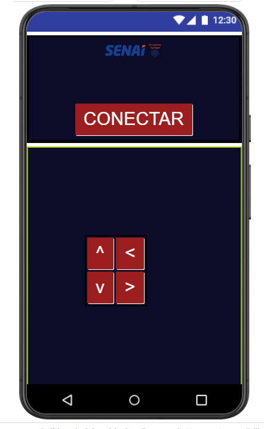

# 🤖 Controle Remoto Bluetooth — Lego Mindstorms NXT

Aplicativo Android desenvolvido no **MIT App Inventor** durante o curso de Desenvolvimento Mobile do **SENAI**. O projeto resolve a necessidade de controlar fisicamente um robô em formato de carrinho (Lego NXT) à distância e em tempo real, substituindo comandos fixos por uma interface tátil intuitiva diretamente no smartphone.

---

## 📱 Demonstração Visual

### Interface do Aplicativo

### Lógica de Programação (Blocos)

---

## 🛠️ Tecnologias e Recursos Utilizados

* **Plataforma:** MIT App Inventor
* **Hardware:** Kit Robótico Lego Mindstorms NXT (Motores A e B + sinalizador)
* **Recursos do Smartphone:** Conectividade **Bluetooth** (`ClienteBluetooth1`), tela sensível ao toque (eventos de pressionar e soltar) e alertas visuais na tela (`Notificador`).

---

## ⚙️ Desafios, Aprendizados e Destaques da Lógica

* **Feedback Visual de Conexão:** Ao tocar em **CONECTAR**, o app busca os dispositivos Bluetooth pareados. Assim que a conexão com o NXT é estabelecida, o botão muda automaticamente para **verde** com o texto `"CONECTADO"`, exibe um aviso na tela e aciona um sinalizador no robô.
* **Controle em Tempo Real (`ToqueParaBaixo` e `ToqueParaCima`):** O maior aprendizado foi garantir que o carrinho respondesse exatamente ao tempo de toque do usuário. Os botões direcionais (`^`, `v`, `<`, `>`) acionam os motores enquanto o dedo permanece pressionado e enviam potência `0` assim que o dedo é solto, evitando que o robô continue andando sozinho.
* **Manobras e Curvas:** Para virar à esquerda ou à direita, os blocos invertem o sentido de rotação entre os motores A e B simultaneamente, permitindo curvas precisas.

---

## 🚀 Como Rodar o Projeto

### Para usar no celular (APK)
1. Baixe o arquivo `controleNXT.apk` disponível neste repositório para o seu smartphone Android.
2. Instale o aplicativo (autorize a instalação de fontes desconhecidas, se solicitado).
3. Pareie o seu celular com o bloco Lego NXT nas configurações de Bluetooth do aparelho.
4. Abra o app, clique em **CONECTAR**, selecione o NXT na lista e utilize os controles direcionais.

### Para abrir e editar os blocos (AIA)
1. Baixe o arquivo `controleNXT (1).aia` deste repositório.
2. Acesse o [MIT App Inventor](https://appinventor.mit.edu/), vá em **Projetos > Importar projeto (.aia) do meu computador** e selecione o arquivo.
